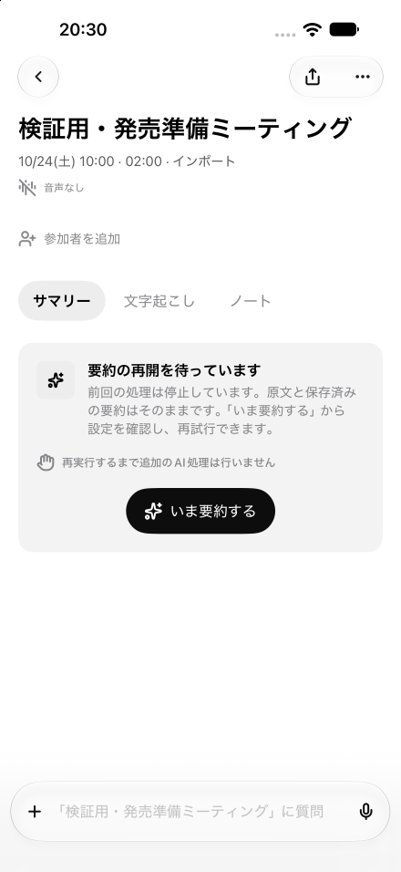

# バックグラウンド要約の継続と復旧

2026-10-24。実端末の障害ログは今回取得していないため、利用者が遭遇した失敗の原因を一つに断定しない。コードで確認できた問題は、即時継続用のAPI未接続、申請エラーの握りつぶし、処理停止を完了とみなすキュー削除、保存確認前の完了扱い、期限切れ時の他ジョブへのキャンセル波及だった。

## 変更

- 利用者が画面から開始した要約に `BGContinuedProcessingTaskRequest` を接続。bundle ID配下の固有IDを許可リストに追加し、実行直前に正確なIDを登録する。iOS 26の対応は維持。iOS 27では非同期申請APIを利用し、利用可能性を分岐する。生成は既存の `MeetingSummarizer` / `ProcessingService` を使い、OSのコールバックから二重に開始しない。
- 継続枠が拒否されても画面上の生成は開始する。短いUIKit実行猶予を補助に使い、継続枠が渡されたら返却する。猶予切れ時は原文・旧要約・選択条件を保持し、再開待ちへ戻す。GPU/Neural Engine用の権限を追加したり、無音再生で実行時間を延ばしたりはしない。
- 画面に戻って自動再開した処理には従来の短いUIKit実行猶予を残すが、利用者の直接操作なしに継続処理を申請しない。OSの予約枠内では、その予約枠の期限処理を使う。
- 推論の進行表示は実際の処理コールバックだけを反映する。生成文字数を完成率に換算せず、完了までは不定進捗とする。結果を保存できた場合に限り、OSへ成功を通知する。
- 予約型の `BGProcessingTask` は自動要約・再起動復旧のために残す。単一のキュー実行所有者とジョブID、`ProcessingService` の実行トークンを照合し、古い期限切れ・遅延完了が新しい要約や文字起こしを止めないようにする。
- 要約・抽出タスク・ジョブ削除は既存SQLiteの同じトランザクションで確定する。保存失敗時は成功表示・Webhook配信へ進まず、旧要約と再試行情報を残す。開始条件の保存に失敗した場合は推論を始めず、生成シートを閉じない。
- 入力のSHA-256には原文（ID・話者・時刻を含む）、旧要約、日時・題名・長さ、プライバシー更新日時、プロジェクトと参加者参照を含める。開始・再開・反映時に照合し、ストリーミングの各更新では全件JSON化しない。ワークスペース世代・復元・保護状態も確認する。旧形式のジョブや入力変更後は、新しい確認なしで再実行しない。
- OSの継続処理の中止と実行期限切れは同じ通知経路のため、安全側で明示再試行待ちとする。バックグラウンドでの通信中断・モデル準備失敗も、無制限の再送・追加課金につながる自動再試行を行わない。APIキー不足など明確な設定不備は通常の失敗理由を表示する。
- 待機中なのに実行中と表現していた文言を「要約の再開を待っています」に変更。元の「いま要約する」から利用者が選択し直せる。ナビゲーション・Liquid Glass・要約/原文の保存形式は変更しない。

## 検証の境界

`run-background-summary-job-checks.sh` は本番のキュー、生成domain、ProcessingService、タスク抽出をコンパイルして実行する。OSスケジューラー、推論応答、未使用モデル項目、TemplateSummaryの描画用付加情報はfixture。隔離した実SQLiteで保存・再オープン・ABORTを検証する。実LLMや実OSの継続動作を証明するテストではない。

fixtureモデルの永続化フックから実 `LocalStore.applyBatch` へ書き込む。`RecordStore` のエンコード用入口はfixtureであり、この検査単独で本番の非同期保存キュー全体を検証したとはしない。既存の保存キュー検査は総合runner側に残す。

検証対象は、成功時の一括保存、原文と旧要約履歴の保持、タスク重複除去、担当/期限の非推測、SQLite保存失敗、開始条件保存失敗、継続枠拒否、期限切れ、利用者中止後の自動再送拒否、古い期限切れ/応答と新しい処理の分離、背景通信切断、入力/権限/プロジェクト/ワークスペース世代/復元状態の変更、単一キュー実行、旧ジョブの確認要求、失敗したOS実行枠を成功報告しないこと。

ホスト検査のSwift 6 strict-concurrency試行は、既存 `MemoraFormat` の共有formatter、次に既存 `LocalStore.shared` の非Sendable共有でコンパイルできなかった。関係のない保存基盤を改変せず、既存ホストrunnerと同じSwift言語モードで実行した。Swift 6完全移行を検証済みとはしない。

`tests/background-summary.e2e.ts` は専用Simulatorだけに明示的な架空データ・停止済みジョブを投入し、再開待ちの表示→確認シート→キャンセル→再起動後も同じジョブ/旧要約/原文を保持することを確認する。モデル呼出は行わず、予約済み状態を実バックグラウンド実行の成功として扱わない。

## 実機で残る確認

- 実機のBYOKとApple Foundation Modelsそれぞれで、画面オフ/他アプリへ移動して長い要約が完了するか。OSの継続枠の許可/拒否、ロック中のファイル保護、メモリ/熱/電池、ネイティブの進行表示・中止を含む。追加推論用entitlementが必要かは未判定で、今回勝手に追加していない。
- 自動要約は引き続きOSが選ぶ予約枠。即時開始や完了時刻は保証しない。強制終了したアプリを任意の時刻に起動する仕組みではない。
- 中断後の再試行は、保存した設定で要約生成をやり直す。生成途中のトークン/区間のチェックポイント復元ではない。クラウド側の処理や課金の取り消しを保証せず、追加実行前に利用者が確認できるようにする。
- 実アカウント、外部送信、実課金は今回使用しない。GitHub Actionsの既知の失敗は別の残課題で、この修正で解消済みとはしない。

## Appleの仕様

- [長時間処理の継続](https://developer.apple.com/documentation/backgroundtasks/performing-long-running-tasks-on-ios-and-ipados)
- [継続処理の開始条件と中止](https://developer.apple.com/documentation/backgroundtasks/bgcontinuedprocessingtask)
- [iOS 27の非同期申請](https://developer.apple.com/documentation/backgroundtasks/bgtaskscheduler/submittaskrequest(_:completionhandler:))

## 最終結果

- 内部処理コミット: `aff4ec5`。その後は画面文言・検証記録を別コミットとする。
- 最終Debugプレビュー成功: `2026-10-24T20-23-10-553bcaef.log`。利用者のプレビューを更新した。
- 最終Release Simulatorビルド成功: `2026-10-24T20-28-34-b2095a6f.log`。両構成とも既存の非推奨API等の警告11件。実機ビルド/実機実行ではない。
- 最終の総合ホスト5系統（next-generation / design-refresh / background-summary / composer-layout / optimization）は全て終了0。`/Volumes/WorkspaceSSD/Development/Temp/memora-background-summary-final-quality-20261024/summary.json`。関連キュー/生成/SQLite検査は単独でも再実行して成功。総合runner自体の回帰4件も成功。
- 最終UI E2E: `.e2e/regression/background-summary-final-20261024/report.json`。選択3件全て成功、失敗/中断/スキップ/不安定0、モデル呼出0・トークン0、205.25秒。停止済みジョブの表示/確認/取消/再起動保持と、決定事項編集/原文保持/長文サマリーPNGの既存回帰を確認した。検出102件のうち選択しなかった99件は今回未実行で、成功に含めない。
- 先行のUI E2Eも3件成功し、文言修正後の単独再確認1件も成功。上記の最終結果とは別の実行で、件数を上乗せしない。途中のビルド中間ファイル直接比較はアクセスできず取りやめ、直接比較を完了したとは報告しない。
- 生成済みアプリのInfo.plistで、`$(PRODUCT_BUNDLE_IDENTIFIER)` が実bundle IDに展開された継続処理の許可IDを確認した。App Group、OAuthスコープ、課金、推論用entitlementは変更していない。
- 環境: Apple Silicon / macOS 27.0.1 / Swift 6.4 / iOS Simulator SDK 27.1 / 専用iPhone 18 Pro Max Simulator。実アカウント・実音声・有料API・利用者のプレビューDBは検証に使用しない。
- 入力遅延・FPS・メモリ・電池・実モデルの処理時間は今回計測していない。テスト所要時間を性能改善率や実バックグラウンド完了率には換算しない。

最終の再開待ち画面を保存・目視確認した。下図は明示的な架空の検証データであり、実モデルの生成結果ではない。変更前の実画面は今回保存していない。最終画面のLight表示のみをこの図の視覚確認済み範囲とする。

