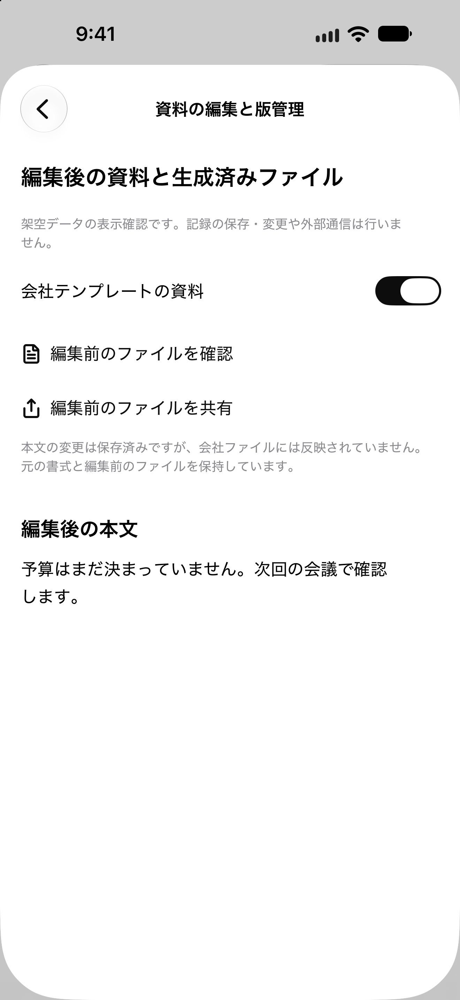
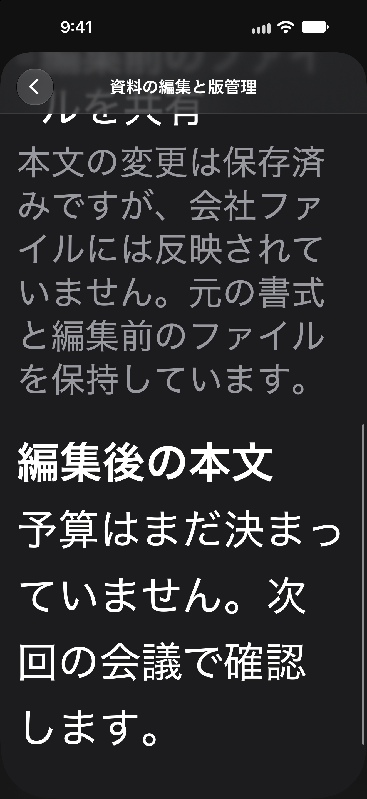

# PowerPoint・企業artifactの改善記録

2026-10-27。標準Swift exporterの改善と、開発専用OSS PoCを明確に分ける。

## 本番アプリの変更

| 項目 | Before | After / 制限 |
| --- | --- | --- |
| 長文スライド | 固定位置、長文は収まりが不安定 | 前回4commitでCoreText共通pagination。本文24pt、元の要点/順序を保持。画面/PDF/PPTXのページ構成を共有 |
| speaker notes | DocumentSlideにあっても標準PPTXへ出ない | notesMaster/notesSlide/relationships/content typesを出力。改ページ時は最初のfragmentへ一度だけ付与 |
| 会社資料の本文編集 | artifact参照/format/templateIDをnilにして生成済みファイルを削除 | 関連/ファイル/出典を保持。optional contentRevision/artifactRevisionで編集前exportを識別。旧dataはrevision0として読む |
| stale export表示 | 編集済み本文と生成済みfileの区別なし | 「編集前のファイルを確認/共有」、会社ファイルへ未反映の注意。未反映の会社Word/PPTXを最新と偽装しない |
| 標準Wordの再出力 | 古いexportの再利用/参照破棄のどちらか | 編集後は最新markdownからDOCXを生成。標準PPTXも最新slidesから生成 |
| 会社file欠落 | fallbackで標準fileを作る可能性 | 会社書式のfileがない場合はerror。別書式で成功を装わない |
| 競合・保存失敗 | 開いた時点の本文が新しい編集を上書きしうる | editorのexpectedUpdatedAtを照合、restore中は拒否。SQLite commit失敗ならmodel/既存fileを変更しない |
| 削除時の共有参照 | 参照fileをそのまま削除 | 他document/templateが参照するfileを削除しない。元の企業PPTXは保護 |

新フィールドはoptionalでSQLiteキー/backup schemaを置換しない。backupは古いファイル参照も保持し、
stale状態をroundtrip。負のrevisionやartifactが本文より先のrevisionはbackupで拒否。
保存済み原本を消す移行・クラウドuploadはしない。
slide titleだけの変更では既存slide ID/notesを維持する。

企業marker差込の再実行UI、任意のアウトラインを元のmasterへ再配置、
artifact全世代の履歴/差分表示は未実装。今回のrevisionは本文と最後の成功exportの関係であり、
クラウド同期revisionではない。企業原本を変更せず、対応できないことを明示する安全策を先に実装した。

## Simulatorで確認した表示

設定 › 診断とプレビュー › 状態と復旧UI › 資料の編集と版管理。
架空データ・一時DOCXのみ、ユーザー記録/SQLiteを変更しない。

| Light / 標準文字 | Dark / 最大Dynamic Type・下へスクロール |
| --- | --- |
|  |  |

iPhone18 Pro Max / iOS27.1のBitrig Simulator。文字を縮めず注意と本文が読めること、
確認/共有ボタンのラベルと44pt以上のframeを確認。実機/VoiceOver音声での検証ではない。
別画面/全stateのsnapshot回帰を完了したという意味ではない。

## 開発専用エンジン比較

PptxGenJS4.0.1 → office-kit0.28.0を外部scratch上のNode22.23.2/arm64で実行。
`tools/poc/pptx-engines.mjs`、`tools/checks/validate-pptx-engine-poc.py`で再現。
node modules、モデル、秘密鍵はアプリ/CIへ追加していない。

- PptxGenJS: 8枚、native editable text/表/棒・線・円chart、connector/図形、写真contain、master/theme、全slide notes。
- office-kit: load→token差込→slide複製→日本語見出し/画像/notes/chart値変更→save→9枚で再load。
- 独立ZIP/XML検査: 3charts + 3embedded XLSX、1native table、9notes、unique shape IDs、変更後chart cache値22/36/48を確認。
- 元の8枚file bytes不変。theme/master/layoutの7partは編集後も存在し、7/7がbyte一致。
- original SHA256: `4fdf89143f272ce670168d5f1dea4c5c05b67e1d5e1025ec7f639330badd619b`。
- ノート複製part名は`notesSlide3-copy1.xml`なども有効。独立checkerは数値名を仮定せずXML rootで数える。

この結果は**本番アプリがnative chart/tableを生成できるようになったことを意味しない**。
Swiftモデル/layoutへ統合する前のPoCであり、iOSにNode runtimeを組み込まない。
Workers Freeへの適合は未検証。Macで約40msの単発生成ができてもCPU10msの枠を満たす証拠ではない。
Presentonはmanifest/構成/テンプレート設計を検討、実行PoCなし。OpenXMLSDKは.NETなしで実行していない。

## 検証結果と限界

- ArtifactOperationsChecks: 本番generation/save/edit/reload・SQLite ABORT・stale画面競合・restore guard・会社原本/生成fileのbyte保持・標準Wordの最新本文再出力を確認。
- DocumentArtifactChecks/SlidePageChecks: 旧codec、日本語/絵文字/長文、XML禁止文字、59derived pages/3notes、editable text/relationship/枠を検査。
- BackupRestoreChecks: revisionとfile/source metadataを含めたroundtrip/不正revision拒否。
- Debug `bitrig preview -platform iOS`成功、既存11warning。compilerだけで画面合格とはしない。
- Microsoft PowerPoint16.114.1とKeynote Creator Studioでfixtureの自動open/PDF exportを試みたが、両方AppleEvent timeout(-1712)。PDF/PNGを得られず、PowerPoint/Keynote最終描画・日本語フォント・重なりは未確認。
- LibreOffice/.NET rendererは未導入。異renderer画像比較、Officeで編集→保存、native PDFとの画像一致は未実施。

残作業: backward-compatibleなtyped slides、2/3column・comparison/table・process・chartのSwift生成、
slide単位の追加/並替/複製/削除/editor、企業size/master/theme/font/placeholdersの構造化分析、
レンダラーごとの視覚検証。高忠実度の会社書式再現に成功したと主張しない。
