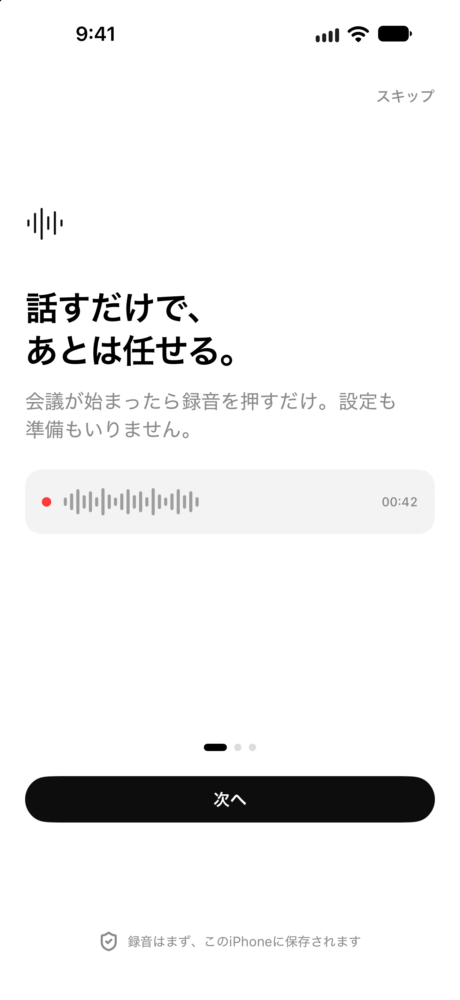
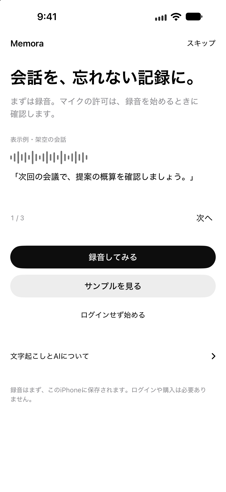
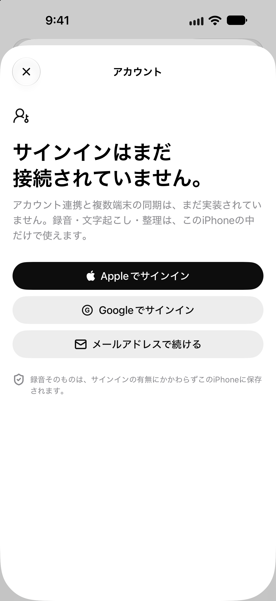
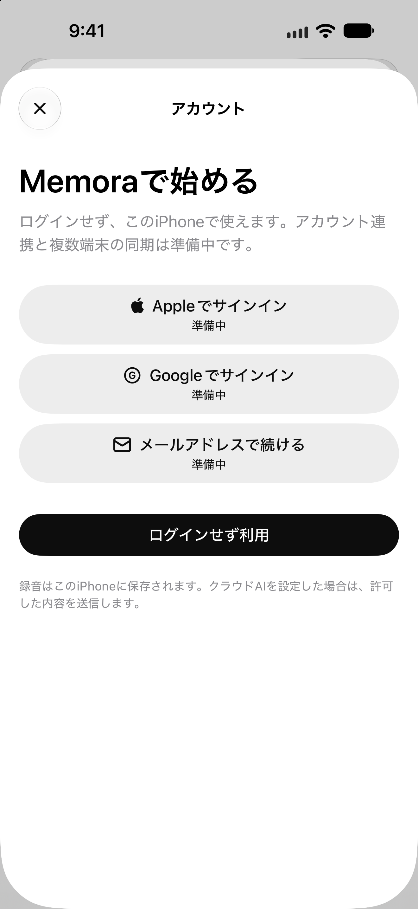
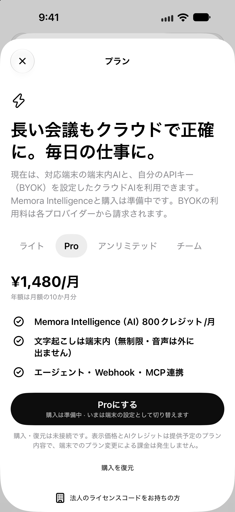
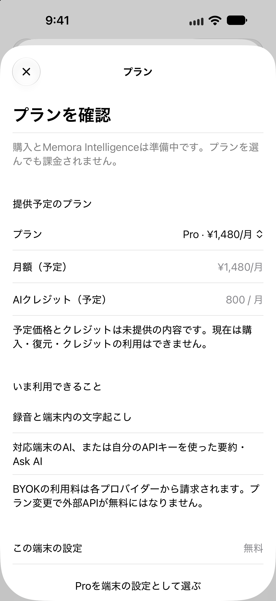
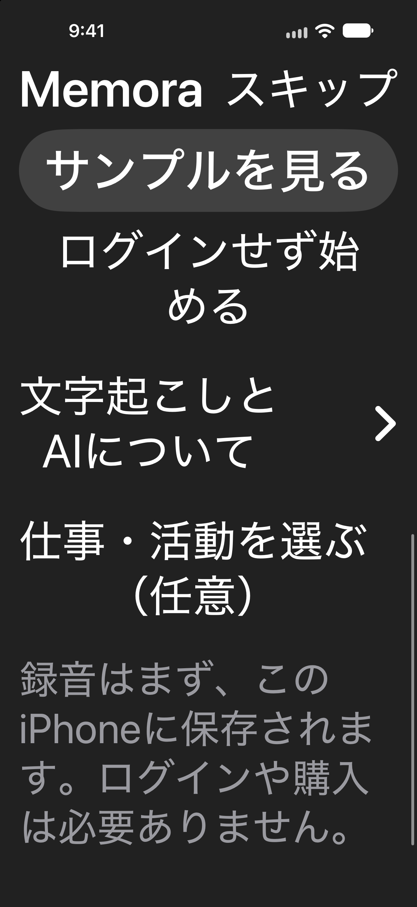
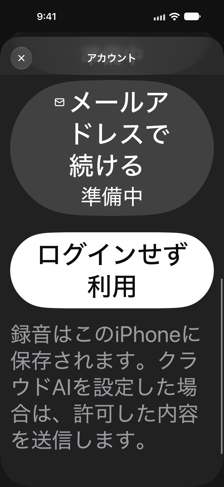
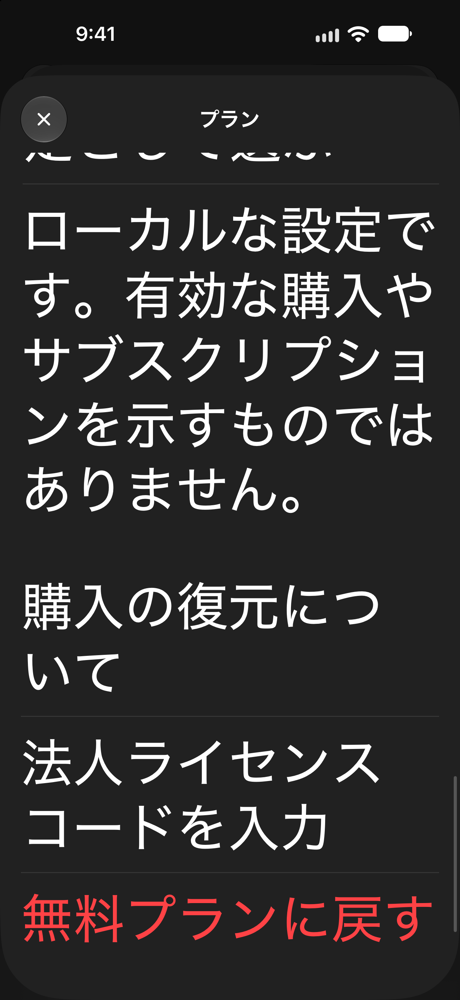

# UI/UX改善・2026-10-27

対象は初回体験・任意ログイン・プラン画面と資料の版表示。
全画面の再設計を完了した報告ではない。native-app-designとApple HIGの
[Onboarding](https://developer.apple.com/design/human-interface-guidelines/onboarding)、
[Managing accounts](https://developer.apple.com/design/human-interface-guidelines/managing-accounts)に沿い、
初回設定を必須にせず、システム文字/scroll/Form/Picker/Menuを利用した。
ロゴ、共通palette、既存Liquid Glass、journalのflatなcalendar/icon、Ask AI/Libraryのナビゲーションは変更していない。

## Before / After

| 画面 | Before | After |
| --- | --- | --- |
| 初回体験 | 3ページを進んだ先に録音/サンプル。固定高さのactions、装飾icon、card内の擬似録音点滅。「設定不要」「終わった瞬間」「担当と期限まで揃う」 | 最初から録音/サンプル/ログインなし利用。説明3ページは任意。共有Typography、スクロール可能な本文とactions。静的なnative波形・実際に読める架空例。権限/モデル準備/時間/記録にない担当者・期限を明確化 |
| ログイン | 接続失敗の大見出し、Appleを主CTAに表示、localに留まる主張がcloud AI設定と混同しうる | Memoraの短い見出し、3providerを同じsecondary style＋準備中に統一、ログインなし利用を主CTAへ。cloud AIへの送信は許可した内容であることを明示。認証やアカウント作成は行わない |
| プラン | 大きなmarketing icon/tagline、縦並びcheckmark特典、未提供creditと現在機能が混在。選択済みは「利用中」。年額割引を確定的に表示 | native Form/Pickerで予定価格・creditと今使えるon-device/BYOKを分離。購入を強調せず、ローカル設定と明示。上限/未接続/外部API費を説明。license入口を選択状態にかかわらず保持。未確定の年額案は画面から外す |
| 資料 | 企業artifactとの関連を編集時に破棄 | [版表示とデータ保護](PRESENTATION_QUALITY_2026_10.md)を追加。本文と生成fileの差を明示 |

| Onboarding Before | Onboarding After |
| --- | --- |
|  |  |

| Auth Before | Auth After |
| --- | --- |
|  |  |

| Plan Before | Plan After |
| --- | --- |
|  |  |

## 重大な副作用の修正

ContentViewのサンプル選択は`loadSampleContent()`を呼んでおり、onboarding再表示時も
meeting/project/task/journal/person/historyを置き換えていた。
既存の`openSummarizedAudioSample()`を独立したdomain extensionに移し、初回体験もそこへ接続した。
サンプル1件をSQLiteへ保存してから開き、既存/編集済みサンプルがあればそのまま開く。
保存失敗/復元中/保護中/team workspaceでは成功扱いせず、初回体験の完了flagも進めない。
debugの明示的な「デモデータを入れ直す（今の内容を置き換えます）」は別操作として残す。

`SamplePreviewChecks`は本番のpreview action・sample・Meeting codec + 実SQLiteを使い、
本人の記録/他collection key/編集済みサンプル保持、重複防止、guard、SQLite ABORT時のrollbackを検証。
recording/AI/mediaアクセスがあればfailするfixtureで、ダミー音声やAI処理成功は作らない。
Simulatorでもサンプルを開き、元のLibraryの3項目が残ることを確認した。

## Simulator検証

iPhone18 Pro Max / iOS27.1、Swift6.4、Debugの実アプリで確認。

- Onboarding: 説明1→2→3、record入口が最初からある、サンプル、local継続、準備条件のdisclosure、スキップを確認。
  録音ボタンは既存の権限確認/録音callbackへ直結し、今回のQAでは新たな録音や権限付与をしていない。
- Auth: 3候補の準備中表示、Appleを押すと未接続理由、アカウントを作成せずlocalで閉じられる。
- Plan: 4つの予定価格のmenu、team選択時の未接続/上限説明、license画面まで開いて未入力で閉じる。
  local planを有料契約として有効化していない。復元処理は未接続で、実購入/返金検証ではない。
- Dark/最大Dynamic Type: 各画面の説明と末尾の操作へscrollで到達。OnboardingはReduce Motionでも静止例。
  iconだけの情報にせず、button label・表示例をaccessibility treeで読めることを確認した。
  VoiceOverの実音声・Switch Control・日本語IME・横向き/小型端末は今回未検証。

| Onboarding・最大文字 | Auth・最大文字 | Plan・最大文字 |
| --- | --- | --- |
|  |  |  |

手動の実画面確認と静的presentation契約を追加したが、これをSnapshotTesting/XCUITestの自動回帰と呼ばない。
詳細は[テスト基盤](QUALITY_TESTING.md)。未整備のtest hostを製品targetへの巨大依存追加で代用しない。

## 残るUI作業

Ask AI/sidebar/journal/library/projectの全state比較、attachment/IME/keyboard、
小型画面/横向き/VoiceOver、onboardingの実録音・モデル取得失敗、paywallの本番取引、
SnapshotTestingのiOS host、slide単位editorは未完了。
操作回数は構造上、録音入口が3tapから1tapになったが、実ユーザーの完了時間/継続率は未測定。
