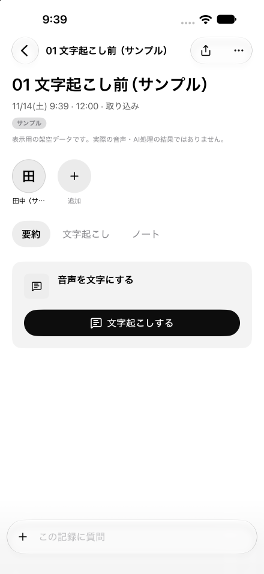
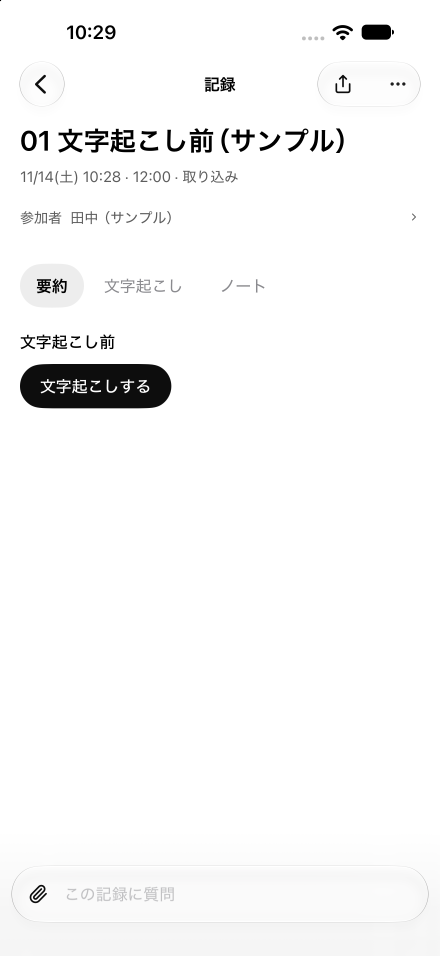
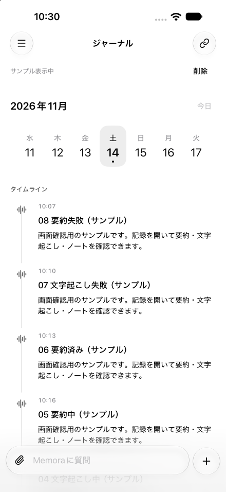
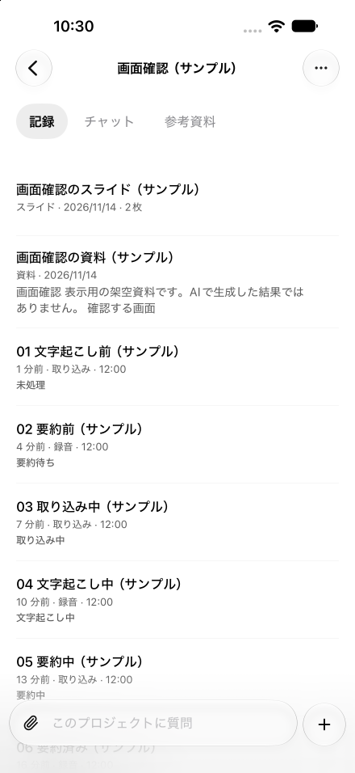

# 全画面の簡素化と一貫性 — 2026-11-14

## 採用した方針

本文・会話・記録を優先する。機能を維持しながら、重複するタイトル、
説明、装飾、操作の入口を整理する。ネイティブの質感は操作部分に残し、
コンテンツをガラスやカードで囲いすぎない。

承認済みの選択：添付はクリップ／記録作成は＋、補助画面への入口は
サイドメニューに表示、プロジェクトは記録が先、ジャーナルは時系列が先。

## 実装内容

| 対象 | 変更 |
| --- | --- |
| 共通操作 | 標準ツールバーの外観を優先。既存の文字・余白・アイコンの役割を使い、44ptの操作領域を維持 |
| サイドメニュー | 静的なロゴ、主要4項目、タスク・資料・人物、右下の設定。選択表示は実際の遷移先と一致 |
| 遷移 | ライブラリ／ジャーナルの再選択で先頭へ。補助一覧は標準の戻る操作。ライブラリのセグメント設定は補助画面への移動で変えない |
| 下部 | ライブラリ・ジャーナル・プロジェクトだけ作成＋を表示。その他はAsk AI、マーケットプレイスは検索。検索／選択中の専用UIを維持 |
| 記録詳細 | ナビゲーションは「記録」、実タイトルは本文に一度だけ。参加者は短い編集行。履歴・再要約は「…」へ |
| 処理状態 | 未処理・失敗・部分失敗は共通の平面表示。処理中は実際の工程と開始時刻だけを使う。未実行の文字起こしを処理中と表示しない |
| 一覧 | 記録はLibraryRecordRow、資料はDocumentRowを再利用。不要な種別アイコンを省き、タイトル・メタ情報・プレビューを左揃え |
| ジャーナル | 日付→時系列→振り返り。時刻は一度だけ表示。末尾の追加と各行のコンテキスト／アクセシビリティ操作で日付付き追加を維持 |
| プロジェクト | 記録／チャット／参考資料の切替を常時表示。初期表示は記録。保存済み識別子は維持 |
| Ask AI | 中央の履歴メニューと両端の操作を整列。提案は最大3件。コピーは直接、その他は「…」。読み上げ中の停止は直接表示 |
| 出典 | 補助的な出典一覧は展開表示。引用リンクと実行時の権限確認は既存のまま |
| マーケットプレイス | ホーム下部の管理リンクを上部メニューへ。詳細は本文タイトル・上部共有／管理・下部主要操作に統一 |
| 人物 | 概要と関連記録が先。タスク・決定・ジャーナルは展開。名前だけ一致した情報は本人未確認として別表示 |
| 設定 | ネイティブFormを使用。現在値と状態を維持し、重複情報を削減。技術説明は展開し、送信・権限・未接続の情報は判断する場所に残す |
| サンプル | タイトルに「サンプル」がある場合はバッジを重ねない。保存内容とサンプルの識別子は変更しない |

## 保持した動作

- SQLite、音声・写真ファイル、下書き、保存済みナビゲーション値は変更しない。
- 録音・取り込みの保存先、グローバル／プロジェクト／記録の質問範囲を維持。
- 添付や入力中の見た目を切り替えても、入力欄とファイル取り込みのホストを取り外さない。
- 複数選択でタイトル幅を変えず、行高のアニメーションを入れない。
- 実行承認・外部送信・本人未確認・共有の閲覧専用表示を維持。
- 未接続サービス、処理結果、件数を捏造しない。処理中サンプルから実ジョブを開始しない。

## 検証

- `bitrig preview -platform iOS`：各実装単位で成功。最終ビルドも成功。
  既存のMapKit・認証画面等に由来する11件の警告は残る。
- 構造・デザイントークンの既存チェック33件、モーション方針チェック：成功。
- `RootNavigationChecks`：保存済みID、質問範囲、作成操作の表示対象を含め成功。
- E2E 7件：成功。実行中に見つかった初回テキスト選択の空表示は、
  本文とシートを一つの値で渡す方式へ修正して再確認した。共有にも同じ方式を適用。
- 組み込みプレビュー：サイドメニュー、記録詳細、ジャーナル、プロジェクト、
  人物、Ask AIを確認。最大文字サイズでメニューの折り返し／スクロールと
  人物一覧・詳細を確認。ライト／ダーク、Reduce Motion有効時の遷移も確認。
- 実機のVoiceOver・戻るジェスチャー、実際のCloudKit共有データ、
  外部AI・コネクタ通信は今回の検証に含まない。ビルド成功をその証拠とはしない。

```sh
npx e2e run tests/screen-review-samples.e2e.ts tests/uiux-simplification.e2e.ts tests/capture-menu-layout.e2e.ts tests/library-selection-layout.e2e.ts --no-cache --output .e2e/uiux-simplification --trace=on
npx e2e run tests/uiux-simplification.e2e.ts tests/answer-actions.e2e.ts --grep 'catalog articles|answer actions open' --no-cache --output .e2e/uiux-articles --trace=on
```

最初の実行は追加前のカタログ詳細テストを含む5件。
後の実行はカタログ詳細と回答操作の2件。各テストは専用シミュレーターで実行し、
組み込みプレビューの保存データを置き換えていない。

確認項目：既存サンプルの保持と重複追加防止、記録8状態、文字起こし／ノート、
ジャーナル、プロジェクトの記録優先と切替、補助一覧の戻る操作、下書き保持、
作成＋の表示範囲、添付メニュー中の入力欄、複数選択時の行寸法、カタログの
管理導線、スキル／テンプレート／コネクタ詳細、回答の選択と読み上げ停止。

## 比較画像

すべて画面確認用サンプル。変更前はこの作業前のE2E成果物、変更後は今回の検証成果物。
日付・経過時間は実行時点によって異なる。

| 記録詳細：変更前 | 記録詳細：変更後 |
| --- | --- |
|  |  |

| ジャーナル | プロジェクト |
| --- | --- |
|  |  |
