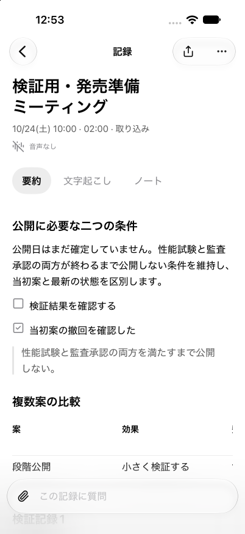
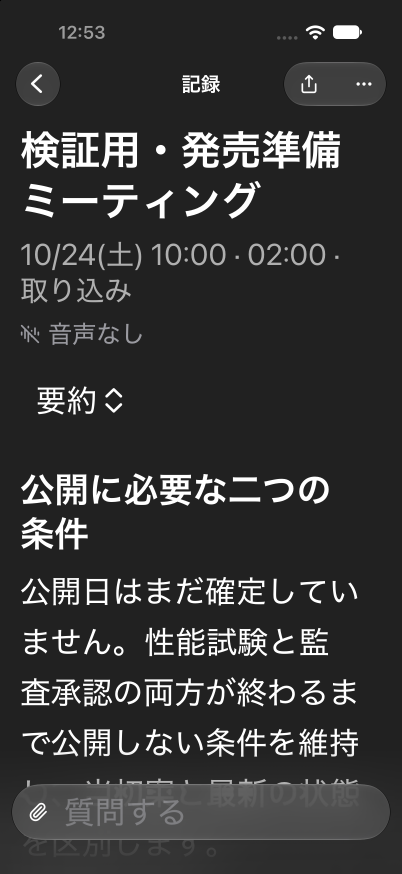

# 確定音声の区間準備パイプライン

2026-11-15。Phase 5の追加単位。通常利用の並列変換は未採用。利用者指定により実モデル評価は実施しない。

## 調査と設計

`RecordedAudioTranscription`は録音終了後のファイル、またはseal済み分割録音manifestを不変スナップショットにする。従来は15分ごとのAAC変換と認識を逐次実行し、同じ`audio.m4a`を再利用していた。そのまま並列化すると認識中の入力を置き換える。また、stage容量は入力上限2GiB+128MiBで、上限100MiBの出力2本を無条件には保持できない。

これは取り込み/STTの構造であり、利用者報告の「文字起こし後の要約120秒」の原因や内訳を実測で確定したものではない。今回の候補だけで要約LLMの処理時間が短くなるとは主張しない。

ライブ表示用STTは録音保護のため入力を落とす場合がある。`isFinal`だけでは原文全体の完全性を保証しないため、ライブテキストを確定原文として再利用したり、クラウドへ先行送信したりしない。

## 実装

- `RecordedAudioTranscription`: 既存パイプライン内に1区間だけ先に変換する候補を追加する。構造化TaskGroupが子タスクを回収する。認識は常に時系列順で1区間ずつ、同じ回数だけ行う。
- `SourceMediaAudioLease`: `chunk-0.m4a`など区間ごとに異なるファイルを保持する。認識終了・失敗・キャンセル時に解放し、取り出されない先読み結果も解放する。stageのflockと削除は既存leaseが担う。
- `RecordedAudioPreparationPolicy`: 通常の`.validated`は先読みを許可しない。候補factoryは`MEMORA_HOST_CHECKS`でのみコンパイルする。UI設定・UserDefaults・新規外部送信は追加しない。

候補は低電力OFFかつthermal nominalを要求する。stage/全stageの実サイズに次の最大出力100MiB分の余地があり、空き容量も既存下限256MiB+100MiB以上と検査する。検査不能/不足なら先読みをせず逐次処理に戻る。検査時点のheadroomであり、他プロセスのディスク消費まで予約する仕組みではない。既存exportの定期的な容量上限検査を維持する。

認識前には準備済み区間でもキャンセルとthermal readinessを再検査する。認識が正常に確定したprefixだけを既存SQLite checkpointへ保存する。音声中間ファイルの永続cacheは新設しない。末尾失敗時に完成原文を返さず、明示的再試行では確定prefixを再認識しない。全区間終了後の原本hash検証も維持する。

resource probeの失敗と実際に開始したexportの失敗は区別する。後者は次の区間境界で処理を失敗にし、自動で変換/認識を繰り返さない。確定prefixからの再開は既存の明示的再試行に従う。SQLite schema、checkpoint key、録音原本、要約履歴、タスク、バックアップ形式は変更しない。従来のcheckpointをそのまま読める。

## 無料host検証

`RecordedAudioPreparationChecks`を既存`run-source-extraction-cache-checks.sh`へ統合した。同じ901秒、16kHz monoの合成WAVで、実AVFoundation AAC変換と固定認識応答を使う。SpeechAnalyzer/LLMは呼び出さない。

- 逐次、先読み候補、resource probe失敗時の逐次fallbackでsegment/ID/話者/本文/開始・終了時刻が一致する。
- 最初の認識callbackを保持したまま次のAAC変換が完了し、実durationを取得できる。認識中のファイルも残る。
- stage/全stage/空き容量の上限ちょうど・1byte不足、低電力、fair/serious/critical、負数・不整合・Int64最大値を検証する。
- 未消費の先読み完了結果を残してキャンセルしても完成原文を返さず、stageを全削除する。実export中のキャンセル到達時間の計測ではない。
- 先読み完了後にthermal seriousとなると最初の確定prefixだけを保持し、冷却後は末尾だけを変換/認識する。
- 末尾認識失敗後の再開でもprefixを再認識しない。
- 先読み後に原本を変更すると全認識終了後も完成結果を拒否し、変更された原本を上書きしない。
- 既存の分割manifest/frame整合性・原本変更・SQLite復元・容量制限の回帰も同じrunnerで継続する。

途中の原本変更テストは、同じURLにキャッシュされた`resourceValues.fileSize`の再利用で失敗した。実ファイルのstatは57,668,096→57,668,097 bytesで追記保持を示し、アプリの原本変更による失敗結果も確認できていた。テストを`FileManager.attributesOfItem`の再読込へ修正して成功。失敗ログ`audio-preparation-reviewed-host.log`も保持する。

実行例（成果物はリポジトリ外）:

```sh
MEMORA_CHECK_ROOT=/Volumes/WorkspaceSSD/Development/Agents/MemoraSummaryPerformanceValidation \
TMPDIR=/Volumes/WorkspaceSSD/Development/Agents/MemoraSummaryPerformanceValidation \
bash tools/checks/run-source-extraction-cache-checks.sh
```

## 有効化前に残ること

実機で同一音声・認識エンジン・用語集・cache条件の反復A/Bが必要。STT単独、要約単独、取り込みから保存までを分離し、P50/P95、peak memory、電池、thermal、録音への影響を比較する。hostで観察した処理の重なりはiPhoneの速度改善の証明ではない。

録音中の確定区間分析、話者変更による分析失効、確定区間とクラウド要約の重なりは未実装。Phase 5全体を完了扱いにしない。実API費用・要約品質・60秒/30秒・録音後10〜20秒も未検証。

## UI確認

UIは変更していない。現ビルドのagent-free E2Eでオンボーディング後の再起動と狭幅・Dynamic Type・ダークモード・表の横スクロール・長文スクロールの2件を確認した。全138件の実行ではない。reportのmodelTokens/maxModelCallsInStepは0。以下は架空の保存済み画面fixtureであり、実モデルの生成品質サンプルではない。




## この単位の統合結果

ガード付き全10群が同一の1,961入力ファイル、内容SHA256 `b57ec0e3e15cb5ffc9e5c7ee917066c4b212e2eaa3b775dc5a12c3fe688b39d7`で成功。実行前後のファイルrevisionも一致した。今回の全10群の途中失敗はなし（前述の追加テスト作成中の失敗は別ログに保持）。iOS preview `2026-11-15T12-47-02-205a8575.log`成功、既存警告11件。E2E run `01a1dd55-70fa-7590-b81a-8c50f6286123`は選択2件/成功2件、modelTokens 0。

機械可読記録: [audio-preparation-results-2026-11-15.json](audio-preparation-results-2026-11-15.json)。全ログは外部作業ディレクトリ`MemoraSummaryPerformanceValidation`の`quality-audio-preparation-2026-11-15`および`audio-preparation-*`。これらのテスト時間を実機のSTT/要約時間として報告しない。速度・費用・品質の実モデル比較値は未取得のまま。
