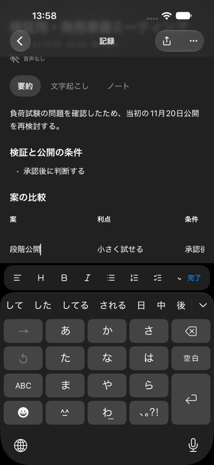

# 確定音声区間の版管理

2026-11-15。Phase 5のローカルな安全基盤を追加する単位。実認識/要約モデル、クラウド送信、課金を実行しない。

## 責務

既存`SourceMediaCheckpoint`に任意の`chunkRevisions`を追加する。新しいDBや、原文を複製する永続化モデルは作らない。`SourceMediaChunkRevision`は区間ID・内容fingerprint・配列範囲を持つ小さな付加情報であり、原文や話者を再生成しない。

区間IDは既存checkpoint keyのhash、区間番号、開始時刻、長さから決定する。keyは既存どおり原本fingerprint、言語、用語集、認識pipeline、OS版、区間長を含む。内容版は元のsegment UUID、本文、話者名/ID/確実性/識別状態、開始/終了時刻、認識engine/model/language/confidence、および抽出blockを含む。生のcheckpoint keyや原文を版情報へ複製しない。

同一ソース/設定の区間IDは本文・話者の修正で変えず、内容版を変更する。元のsegment IDは置き換えない。境界上の発言が同じ絶対時刻になる場合でも、区間完了時に記録した配列範囲で所属を区別する。時刻だけから過去の区間境界を推測しない。

維持できるのは、同じ不変原本に対する認識prefixの伸長である。録音ファイル自体が増える場合は原本keyが変わる。録音中のsealed part単位でIDを維持する設計は、この単位では提供しない。

`RecordedAudioTranscription`は認識が正常に完了し、時刻を全体座標へ変換した後に版を付ける。`SourceMediaExtraction`も同様に、動画/外部音声の確定block範囲を記録する。無音区間は空の範囲を持てる。ライブ表示テキストを確定原文として登録しない。

## 保存・照合・互換性

- 既存の上限12件/32MiB/1件12MiB/7日と、generationによる旧workerの保存拒否を維持する。SQLite schemaとkeyの変更はない。
- 読込/保存時にID、版、範囲、時刻、順序を検証する。本文や話者が変わった区間の版を除外し、変更のない区間の版を維持する。重複・範囲の重なり・順序破損などは版情報全体を除外する。
- 版情報がない旧cacheは従来どおり再開できる。ただし、その区間を版管理済みとみなさない。旧prefixから再開した場合、新しく確定した区間だけに版を付ける。
- 版情報の型破損や未知schemaは、正常な文字起こしを読み込む妨げにしない。本文自体の既存検証は緩めない。
- 版情報を含めると従来の容量上限を超える場合は任意の版情報を省略して保存する。本文を削減しない。本文だけでも上限を超える場合の既存拒否を維持する。
- `SourceMediaCheckpointStore.isCurrent`は、現在のSQLite entryとgenerationへ照合する。保存失敗・失効・期限切れ・再開後の変更を、手元の古いtokenだけで有効と判定しない。

## 権限と全体文脈の境界

版tokenはアクセス許可でも、事実の正しさの保証でもない。後続処理は送信前/保存前に原本、record/workspace、privacy、既存cache leaseを再検査する必要がある。今回、先行分析のconsumerやクラウド呼出しは接続しない。

照合は既存のcache読込経路（LRU touchを含む）を利用する。将来consumerを接続するときは常時pollingを避け、一括照合と書込頻度を評価する。cache I/O/JSON検証を画面の描画処理へ置かない。

保存後の記録本文・話者編集に対する既存`SummaryArtifactCache`の保守的な全体失効は維持する。今回の区間版照合だけで、その失効を細分化したわけではない。checkpointの認識結果が有効でも、編集後の記録へ同じ分析を適用してよいとは限らない。

変更のない区間を後から参照できても、後半での訂正/撤回を無視して前半の判断を最終決定へ昇格しない。全体統合と最終原本検証は依然必須。tokenを人物記憶や「全文を分析済み」という状態へ自動昇格しない。

## 無料検証

`run-source-extraction-cache-checks.sh`にproduction codec/storeを使うhost testを統合する。

- SQLite再起動後の照合、prefix追加後も変わらない区間の保持。
- 同じ900秒の発言を異なる2区間へ所属させ、配列範囲と元UUIDを保持する。
- 本文/segment ID/話者名/話者ID/確実性/識別状態/開始/終了/engine/model/language/confidenceの12変更で旧版を拒否し、未変更の区間を維持する。
- 壊れた付加情報、旧形式、未知schema、負数/Int最大値、重複/重なり/順序、範囲外時刻、異なる原本/言語/用語集/pipelineを検証する。
- blockと無音、保存不可、期限切れ、削除/clear後の旧writer、容量不足時の本文保持を検証する。
- 実WAV→AAC＋固定認識応答の失敗/再開で、production producerが版を保存し、prefixの版とsegmentを引き継ぐことを確認する。認識結果の品質評価ではない。

通常先読み/SoT gateは閉鎖を維持する。実機速度、電池、発熱、録音中の完全な確定原文、実モデル品質/費用は未検証。

## UI回帰

現ビルドのagent-free E2Eで、適応型要約のタスク操作/根拠/履歴/編集と、保存失敗後の原文/ドラフト保持の2件を確認した。UIを変更していない。全138件の実行や実機認証の証明ではない。スクリーンショットは保存済み架空fixtureであり、生成モデルの品質サンプルではない。

## 統合結果

ガード付き全10群が同じ1963入力ファイルで成功。内容SHA256 `7cb7a8643a05431a70f17e6b2faeadeaeb979a63526ca3ac8992269a170dd542`とファイルrevisionが実行前後で一致した。今回の無料統合runに失敗・修復・再実行はない。

iOS preview `2026-11-15T13-51-04-a5814d03.log`成功、既存警告11件。E2E run `01a1dd8f-6520-7e61-835e-0cbd00c2a313`は選択2件/成功2件、modelTokens/maxModelCallsInStepは0。画面のスクリーンショットも確認した。

[機械可読記録](settled-revisions-results-2026-11-15.json)を保存。ログは外部作業ディレクトリの`settled-revisions-*`と`quality-settled-revisions-2026-11-15`。これらのテスト時間を実機の処理時間やモデル品質の改善として扱わない。
